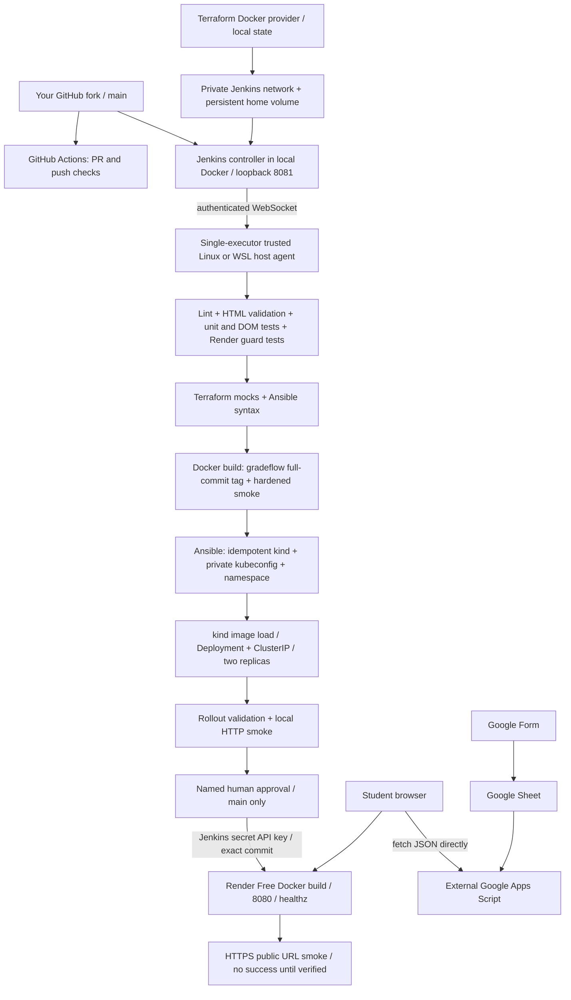

# GradeFlow — local DevOps + Render Free (no OCI account)

GradeFlow displays Google Forms/Sheets submissions through an external Google Apps Script JSON endpoint. The frontend, browser-local frequent-student highlighting and existing API integration are preserved. **It does not grade assignments or store marks.** Original frontend by Prishu Raj Singh; all changes belong to [Joshi-taro/GradeFlow](https://github.com/Joshi-taro/GradeFlow).

The primary path needs no cloud VM, registry subscription or credit card: Docker runs a private Jenkins controller, a trusted Linux/WSL host agent builds images, and kind runs two local replicas. Render Free hosts a separate public Docker web service built from the same approved Git commit. Render does **not** host Jenkins or the kind cluster, and its rebuilt image is not asserted to have the same digest as the locally built image.



## Cost and security boundaries

Use a free Render workspace and **Free** web service only. No database, persistent disk, custom domain purchase, paid build tier or paid instance is needed. Render's [Free documentation](https://render.com/docs/free) describes idle sleep after 15 minutes, cold starts, usage limits and suspension. Do not add uptime pings to defeat sleeping. Local Docker/WSL uses your own machine's resources. Docker Desktop is free for personal/educational use subject to its license; Linux Docker Engine is another option.

A no-card account must actually be permitted by Render. **If your account requests a card or paid upgrade, stop; do not enter payment details or switch plans.** Local Jenkins/kind still provides the complete six-tool university demonstration, but the public-hosting requirement remains blocked. No provider can be promised to waive account verification. The public deployment is a university demo, not highly available production hosting.

Jenkins binds only to `127.0.0.1:8081`; kind API and port-forwards bind loopback. No public Docker socket, Jenkins endpoint, Kubernetes admin interface or ingress is created. The controller has no Docker socket. The host agent has Docker access (effectively host-admin access), so run **only reviewed main code** there. PRs run on disposable GitHub Actions runners with no deployment secrets. The local kind kubeconfig is cluster-admin for this disposable local cluster only; do not use it for cloud or shared clusters.

## Exact numbered setup guide

Commands are Bash in Ubuntu 24.04 or Ubuntu 24.04 WSL2, from the repository root unless stated otherwise. Keep your Linux repository under `~/GradeFlow`, not a Windows-mounted folder, for normal use. Docker Desktop users must enable Linux containers and WSL integration for their Ubuntu distribution. Allocate roughly 4 CPUs / 8 GB to Docker if available. Keep the laptop and agent running during Jenkins builds.

### 1. Review and merge the no-card PR in your fork

Wait for all GitHub checks to pass. This PR does not connect or deploy Render. Then:

```bash
git clone https://github.com/Joshi-taro/GradeFlow.git ~/GradeFlow
cd ~/GradeFlow
git switch main
# If already cloned: git switch main && git pull --ff-only origin main
```

### 2. Prepare the local Linux tools and run tests

Install Docker Engine using its [Ubuntu guide](https://docs.docker.com/engine/install/ubuntu/), or use Docker Desktop WSL integration. `docker info` must work as your normal user. Do not enable an unauthenticated TCP daemon. Then inspect and run the supplied official-download installer (uses sudo for Ubuntu packages):

```bash
less scripts/install-local-tools.sh
bash scripts/install-local-tools.sh
export PATH="$HOME/.local/bin:$PATH"
# Put that export in ~/.profile too, and use it in the agent terminal.
node --version                       # v24.15.0
terraform version                    # v1.16.3
kind version                         # v0.33.0
kubectl version --client              # v1.36.4
java -version                        # Java 21
docker info
npm ci --ignore-scripts
npm run check
python3 -m venv .runtime/venv
.runtime/venv/bin/pip install -r infra/ansible/requirements.txt
.runtime/venv/bin/ansible-playbook --syntax-check -i localhost, infra/ansible/local.yml
PATH="$PWD/.runtime/venv/bin:$PATH" bash scripts/check-config.sh
```

The installer verifies downloads against vendor checksum files over HTTPS. It supports Linux amd64 and arm64. Ansible runs on Linux, not native Windows. Node 20 is too old for the existing HTML validator.

### 3. Review Terraform's local Jenkins plan, then approve it yourself

Terraform meaningfully manages the controller container, dedicated Docker network and persistent Jenkins home volume using `kreuzwerker/docker`. It has **no OCI provider or cloud credentials**. Do not also start `ci/jenkins-compose.yaml`: it is a retained alternative, and would compete for the same port. No `terraform apply` has been run for you.

```bash
umask 077
mkdir -p "$HOME/.config/gradeflow/terraform"
chmod 700 "$HOME/.config/gradeflow" "$HOME/.config/gradeflow/terraform"
terraform -chdir=infra/local init -reconfigure -lockfile=readonly \
  -backend-config="path=$HOME/.config/gradeflow/terraform/terraform.tfstate"
terraform -chdir=infra/local fmt -check -recursive
terraform -chdir=infra/local validate
terraform -chdir=infra/local test        # mocked provider: no containers created
terraform -chdir=infra/local plan -out="$HOME/.config/gradeflow/terraform/jenkins.tfplan"
```

Inspect the plan: one network, one volume, image pull and loopback controller container. **Only if you approve these local resources**, run:

```bash
terraform -chdir=infra/local apply "$HOME/.config/gradeflow/terraform/jenkins.tfplan"
rm "$HOME/.config/gradeflow/terraform/jenkins.tfplan"
docker exec gradeflow-jenkins cat /var/jenkins_home/secrets/initialAdminPassword
```

Treat that password as secret. Visit `http://127.0.0.1:8081`, unlock Jenkins, install suggested plugins plus **GitHub Branch Source**, **Pipeline**, **Credentials Binding** and **Pipeline: Input Step** if missing. Create an administrator with username **gradeflow-admin** (the pipeline approval allowlist). Enable authentication, deny anonymous access, set the controller's built-in node executors to **0**, and leave the inbound TCP agent port disabled. Set Jenkins URL to `http://127.0.0.1:8081/`.

Keep Terraform state outside workspaces because Jenkins deletes its workspace after builds. Back up the state and `gradeflow-jenkins-home` volume privately; that volume contains Jenkins credentials. Never commit either. The volume has `prevent_destroy`; do not remove this protection casually. Normal reconciliation is another reviewed plan/apply. Do not run destroy as a cleanup shortcut.

### 4. Connect a trusted local host agent

In **Manage Jenkins → Nodes → New Node**, create permanent node **gradeflow-local**, remote root `/home/YOUR_LINUX_USER/jenkins-agent`, label **gradeflow-local**, **1 executor**, usage “only build jobs with label expressions matching this node”. Choose “Launch agent by connecting it to the controller”. Save. Use the displayed agent secret, not an invented value.

In a dedicated Ubuntu terminal (same user as Docker and the tool installation):

```bash
export PATH="$HOME/.local/bin:$PATH"
mkdir -p "$HOME/jenkins-agent" "$HOME/.config/gradeflow"
chmod 700 "$HOME/.config/gradeflow"
curl -fsSLo "$HOME/jenkins-agent/agent.jar" http://127.0.0.1:8081/jnlpJars/agent.jar
read -rsp 'Paste node secret from Jenkins: ' AGENT_SECRET; echo
(umask 077; printf '%s' "$AGENT_SECRET" > "$HOME/.config/gradeflow/agent-secret")
unset AGENT_SECRET
java -jar "$HOME/jenkins-agent/agent.jar" -url http://127.0.0.1:8081/ \
  -secret @"$HOME/.config/gradeflow/agent-secret" -name gradeflow-local \
  -webSocket -workDir "$HOME/jenkins-agent"
```

Leave this terminal running. No port 50000 or public webhook is needed. Do not attach this agent to PR jobs or other untrusted projects. If WSL cannot reach localhost 8081, fix Desktop WSL integration/localhost forwarding; do not change the binding to `0.0.0.0`.

### 5. Create the main-only Jenkins job and verify local deployment

Create a **Multibranch Pipeline** named `GradeFlow-main`. Add a Git source with repository **`https://github.com/Joshi-taro/GradeFlow.git`** (public clone needs no token). Add **Filter by name (with wildcards)**, include **main**, exclude blank. Do not enable PR discovery or fork discovery. Script path: `Jenkinsfile`. Configure a periodic folder scan (e.g. 5 minutes) or use “Scan Multibranch Pipeline Now”; no public webhook required. Only administrators should configure jobs or credentials.

The first indexing build installs the parameters and runs validation/build only. Next open the **main** child job → **Build with Parameters**, enable **DEPLOY_LOCAL**, leave **DEPLOY_RENDER unchecked**. This creates/reconciles kind through Ansible, loads `gradeflow:<full Git SHA>` directly into kind (no image publish), applies the preserved two-replica manifests, waits for rollout and smoke-tests the service. Terraform validation in Jenkins uses mocks; the controller's real apply remains an operator action so a build cannot replace its own controller.

Independent local commands, if you want to inspect each step:

```bash
.runtime/venv/bin/ansible-playbook -i localhost, infra/ansible/local.yml
.runtime/venv/bin/ansible-playbook -i localhost, infra/ansible/local.yml # expect changed=0
COMMIT=$(git rev-parse HEAD)
docker build -t "gradeflow:$COMMIT" .
bash scripts/local-deploy.sh "gradeflow:$COMMIT"
export KUBECONFIG="$HOME/.config/gradeflow/kubeconfig"
kubectl --context kind-gradeflow -n gradeflow get pods
kubectl --context kind-gradeflow -n gradeflow port-forward --address 127.0.0.1 service/gradeflow 8080:80
# Open http://127.0.0.1:8080; Ctrl-C stops only the port-forward.
```

The second Ansible run checks Docker/kind, reconciles private credentials and namespace, and does not recreate an existing cluster. Cluster version changes require a deliberate operator migration; this playbook does not silently delete/rebuild clusters. Two replicas on one laptop are not high availability.

### 6. Connect Render to your fork and approve the first public deployment

You already have a Render account. Sign in, choose **New → Web Service**, connect GitHub, and grant Render access to **Joshi-taro/GradeFlow only**. Do not select your friend's repository. Choose these values (also recorded in `render.yaml`):

| Setting | Exact value |
|---|---|
| Repository / branch | `Joshi-taro/GradeFlow` / `main` |
| Runtime | Docker |
| Root directory | blank (repository root) |
| Dockerfile / context | `./Dockerfile` / `.` |
| Instance type | **Free** |
| Build tier | Default Starter build tier, never Performance (this is separate from the instance type, which must remain Free) |
| Health check path | `/healthz` |
| Environment variable | `PORT=8080` |
| Auto-Deploy | **Off** |
| Docker command override | blank (preserve Dockerfile command) |
| Disks / databases / previews | none / none / disabled |

The existing Nginx binds `0.0.0.0:8080`, has `EXPOSE 8080`, and serves `/healthz`; Render terminates HTTPS. Nginx does not dynamically substitute PORT, so keep PORT set to 8080. Keep the Free build/compute options; stop if payment is requested.

**Clicking Create Web Service starts the first public build/deploy, even with auto-deploy off.** This is your explicit manual publication approval; review the public contents first. No account action has been taken for you. Alternatively importing `render.yaml` as a Blueprint also requires approval and starts an initial deploy; do not create both services.

Wait for Render to report Live. Record the assigned HTTPS `onrender.com` URL and actual commit. In your terminal:

```bash
node scripts/smoke.mjs https://YOUR-SERVICE.onrender.com
```

Allow a cold start and rerun if necessary. Open the URL and test refresh/submissions/error states. The smoke checks static assets and health, not private Google data. Verify the actual Google Apps Script deployment grants intended read access and supports browser CORS. Never paste student data or secrets into screenshots.

### 7. Store Render credentials in Jenkins, then request an approved release

Render Account Settings → API Keys: create a dedicated key for this demonstration. Render Service Settings/Dashboard URL: copy the **service ID** beginning `srv-`. Do not use the secret deploy-hook URL. Keep the API key private and revoke it when no longer needed; it may have broader account access than this one service.

In Jenkins, put credentials in the `GradeFlow-main` folder's credential store (restrict job configuration rights):

| Jenkins type | ID | Value |
|---|---|---|
| Secret text | `render-api-key` | Your real Render API key |
| Secret text | `render-service-id` | Your service's `srv-...` ID |

Do not put credentials in Git, a Jenkins parameter, Terraform state, Render frontend variables or shell history. The pipeline binds them only after the human gate. It validates the service is Free, Docker, fork/main, `/healthz`, with auto-deploy off and no disk. It submits the exact tested commit, polls the returned deployment ID, checks the deployed SHA, then smoke-tests the public URL. A failed or timed-out request fails the build; it does not repeatedly submit deploys.

Run **Build with Parameters** on `main` with **DEPLOY_LOCAL=true** and **DEPLOY_RENDER=true**. After all local checks pass, sign in as **gradeflow-admin**, inspect the commit/service/Free plan and approve “Approve public Render release”. Declining or timing out prevents the API call. Wait for both the Render API confirmation and the six public smoke checks. Only then record the URL as verified. No registry publishing is involved.

### 8. Capture evidence and test rollback

Save screenshots of Jenkins stage results and approval, Render Free plan/auto-deploy off/commit, public UI, two ready kind pods, Terraform plan, and Ansible's second run with `changed=0`. Redact secrets and student data. See [verification record](docs/LOCAL-RENDER-VERIFICATION.md) for what was actually tested before your account setup.

For a local rollback, select a previously tested full SHA that is on main and rebuild/load that version before deploying it. This works even if kind has discarded an older cached image:

```bash
export KUBECONFIG="$HOME/.config/gradeflow/kubeconfig"
kubectl -n gradeflow rollout history deployment/gradeflow
GOOD_SHA=REPLACE_WITH_PREVIOUS_FULL_MAIN_COMMIT
# From your operator checkout, with a clean working tree:
git switch --detach "$GOOD_SHA"
docker build -t "gradeflow:$GOOD_SHA" .
kind load docker-image --name gradeflow "gradeflow:$GOOD_SHA"
bash scripts/deploy.sh "gradeflow:$GOOD_SHA"
bash scripts/deploy-smoke.sh
git switch main
```

For Render, manually approve a rollback to a known-good previous deploy in its dashboard and verify the public URL again. Free supports only a limited number of previous deploy rollbacks; keep the source SHA in your evidence. For the normal reviewed pipeline path, revert the faulty commit on main in a new PR, run checks, merge, and approve a fresh Jenkins release. Never use `latest` for Kubernetes. A failed rollout is reported, not automatically hidden by rollback.

## Audit, retained legacy files and viva

The original defect audit is [docs/AUDIT.md](docs/AUDIT.md). This change fixes an architectural blocker: OCI signup requires payment verification, the primary Jenkins pipeline required GHCR publishing and OCI/K3s credentials, and the old README centered a cloud VM. The existing Dockerfile, frontend/API, 13 original tests, manifests, and deployment/smoke scripts remain intact. New tests cover Render safety and failure handling.

Optional historical OCI path: [docs/OCI-LEGACY.md](docs/OCI-LEGACY.md), `infra/terraform/`, `infra/ansible/site.yml`, and `ci/Jenkinsfile.oci`. These are **not used by the primary pipeline**. Legacy docs describe actions requiring separate approval and an eligible account; do not follow them for the no-card setup. Existing OCI mock checks remain credential-free in GitHub Actions.

Viva: Terraform manages Jenkins container/network/volume lifecycle and state. Ansible reconciles the local cluster prerequisites, private kubeconfig and namespace. Docker packages the unchanged frontend as non-root Nginx. Kubernetes provides two replicas, probes, resource limits and rolling updates. Jenkins runs tests and coordinates approved releases; GitHub Actions checks PRs independently, including disposable kind integration. Render serves the public Docker build of the same commit. Google Apps Script remains an independent external data dependency; neither Nginx health nor mocked tests prove that API works.
