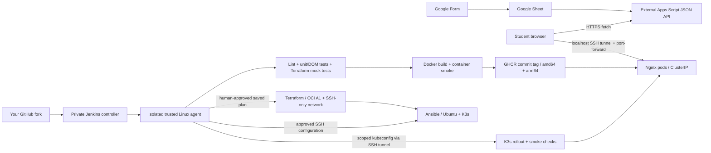

> **Optional legacy path.** Start with [the primary local + Render guide](../README.md). This historical OCI setup requires a separate eligible account and explicit infrastructure approval. Commands assume the repository root.

# GradeFlow — tested static portal with Jenkins, Docker, K3s, Terraform and Ansible

GradeFlow displays Google Forms/Sheets submissions through an external Google Apps Script JSON endpoint. It preserves the original HTML/CSS interface, refresh, activity feed and browser-local frequent-student highlighting. **It does not grade assignments or store marks.** Original frontend by Prishu Raj Singh; this upgrade targets the [Joshi-taro/GradeFlow fork](https://github.com/Joshi-taro/GradeFlow), not the original repository.



The default deployment is private: no Ingress, NodePort, cloud load balancer, public Jenkins, public Kubernetes API or Docker API/socket. The VM has an ephemeral public IP for SSH **only from your operator /32**. The browser calls Google directly; Kubernetes does not host the Sheet/API. A single VM is not highly available, even with two replicas.

Audit and known defects: [docs/AUDIT.md](AUDIT.md). Recorded checks and limits: [docs/VERIFICATION.md](VERIFICATION.md).

## Prerequisites and cost boundary

Use Linux or Ubuntu 24.04 WSL with Bash for deployment commands. Install Git, Node **24.15.0**, npm **12.2.1**, Python 3.12 plus `python3-venv`, Docker Engine/Desktop with Buildx, `kubectl` compatible with your cluster, Terraform **1.16.3** (minimum 1.7 for mocks), SSH, curl and optionally kind. Jenkins agents additionally need Java 21 and the tools above. Do not run Ansible from native Windows.

OCI requires your account, home region, compartment, availability domain, an SSH key pair and a reviewed **Canonical Ubuntu 24.04 ARM platform image** compatible with `VM.Standard.A1.Flex`. Select the image OCID in that region; never use a paid Marketplace image. No cloud credentials are needed for local tests.

As checked on 2026-10-22, [Oracle's current Always Free documentation](https://docs.oracle.com/cd/E97706_01/Content/FreeTier/resourceref.htm) lists 1,500 A1 OCPU hours and 9,000 GB hours monthly (approximately 2 OCPUs/12GB), and 200GB combined boot/block storage. Older tutorials often quote 4 OCPUs/24GB. This configuration uses **one A1 VM, 2 OCPUs, 6GB RAM, 50GB balanced boot volume**; it adds no NAT gateway, reserved IP, paid load balancer, database, backup policy or extra volume. The limits are shared with everything else in your tenancy. Verify your own current terms, remaining quotas, image eligibility, free storage and egress before approval; Terraform cannot certify a zero bill. Use an unupgraded free account where appropriate and inspect Cost Analysis; budget alerts are not spending caps. A1 capacity may be unavailable and idle free VMs may be reclaimed. **Use local kind if unavailable; do not substitute a paid shape/region or retry a paid service.**

## Local frontend and reproducible checks

All commands below start from the fork's repository root unless `cd` is shown. Replace explicit `YOUR_...` values; do not paste them unchanged.

```bash
git clone https://github.com/Joshi-taro/GradeFlow.git
cd GradeFlow
git switch main                    # after merging the upgrade PR into your fork
node --version                     # v24.15.0
npm --version                      # 12.2.1
npm ci --ignore-scripts
npm run check                      # ESLint + HTML validation + Node unit/DOM tests
npm run serve                      # loopback only, http://127.0.0.1:8080
```

In another terminal at the repository root:

```bash
npm run smoke -- http://127.0.0.1:8080
terraform -chdir=infra/terraform init -backend=false -input=false -lockfile=readonly
terraform -chdir=infra/terraform fmt -check -recursive
terraform -chdir=infra/terraform validate
terraform -chdir=infra/terraform test    # mock provider only; no cloud resources
python3 -m venv .runtime/venv
.runtime/venv/bin/pip install -r infra/ansible/requirements.txt
.runtime/venv/bin/ansible-playbook --syntax-check -i infra/ansible/inventory.ini.example infra/ansible/site.yml
for script in scripts/*.sh; do bash -n "$script"; done
```

The Node tests exercise actual dashboard JavaScript with mocked API data in jsdom. They cover stored HTML injection, unsafe links, HTTP/malformed API errors, retry, empty results, invalid timestamps, frequent-student sorting, storage corruption, timeout and refresh races. They do not fetch real students' data. Smoke testing checks HTTP content and assets; it does not prove the external API is reachable. `healthz` checks Nginx; Apps Script availability is a separate browser check.

## Docker and local Kubernetes

The base Nginx multi-platform index is pinned by digest. The image serves only five frontend assets plus CSS, runs as UID/GID 101 on 8080, and writes temporary files only under `/tmp`. No source repository, state or credentials enter the image. Rebuild deliberately when updating base digests.

```bash
COMMIT=$(git rev-parse HEAD)
IMAGE="gradeflow:$COMMIT"
docker build -t "$IMAGE" .
docker run --name gradeflow-demo --rm -d --read-only \
  --tmpfs /tmp:uid=101,gid=101,mode=1777,size=16m \
  --cap-drop=ALL --security-opt=no-new-privileges \
  -p 127.0.0.1:8080:8080 "$IMAGE"
npm run smoke -- http://127.0.0.1:8080
docker inspect --format '{{.State.Health.Status}}' gradeflow-demo  # after healthcheck interval
docker stop gradeflow-demo
kind create cluster --config local/kind.yaml
kind load docker-image "$IMAGE" --name gradeflow
kubectl --context kind-gradeflow apply -f k8s/namespace.yaml
kubectl config use-context kind-gradeflow
bash scripts/deploy.sh "$IMAGE"
bash scripts/deploy-smoke.sh
kubectl -n gradeflow port-forward --address 127.0.0.1 service/gradeflow 8080:80
# Visit http://127.0.0.1:8080; Ctrl-C ends the port-forward.
```

`local/kind.yaml` pins a Kubernetes v1.36.4 node digest (kind v0.33.0) with a loopback-only API. For another supported version review the namespace's pinned Pod Security version (v1.36). For an existing local K3s server use its admin kubeconfig, apply the namespace, import the image with `mkdir -p .runtime && docker save "$IMAGE" -o .runtime/gradeflow.tar` then `sudo k3s ctr images import .runtime/gradeflow.tar`, and run the same deploy/verify commands. Ansible supports Ubuntu 24.04+ with swap disabled; the playbook can also configure an approved local Ubuntu VM. A local K3s install is privileged host configuration, so review it before running.

## Oracle infrastructure — approval required

**Do not execute `terraform apply` until you explicitly approve provisioning. No apply was run to prepare this repository.** The following is the command sequence for the operator after review, not an automatic action. First prepare a separate SSH key with a passphrase and store OCI API credentials outside Git using `~/.oci/config` or the provider's `OCI_TENANCY_OCID`, `OCI_USER_OCID`, `OCI_FINGERPRINT`, `OCI_PRIVATE_KEY_PATH` environment variables. Limit the OCI IAM principal to the chosen compartment's required compute/network operations. Never place the OCI private key in tfvars.

```bash
ssh-keygen -t ed25519 -f "$HOME/.ssh/gradeflow" -C gradeflow
mkdir -p "$HOME/.local/state/gradeflow"
chmod 700 "$HOME/.local/state/gradeflow"
cp infra/terraform/terraform.tfvars.example infra/terraform/terraform.tfvars
# Edit terraform.tfvars: home region, compartment, AD, Ubuntu ARM image OCID,
# public key from ~/.ssh/gradeflow.pub, and YOUR operator's public IPv4 /32.
# Keep free_tier_confirmed=false until account eligibility/budget are reviewed.
terraform -chdir=infra/terraform init -reconfigure -input=false -lockfile=readonly \
  -backend-config="path=$HOME/.local/state/gradeflow/terraform.tfstate"
terraform -chdir=infra/terraform validate
# After explicit provisioning approval + eligibility review, edit
# free_tier_confirmed=true. This acknowledgement alone cannot guarantee cost.
umask 077
terraform -chdir=infra/terraform plan -input=false \
  -var-file=terraform.tfvars -out=approved.tfplan
terraform -chdir=infra/terraform show approved.tfplan
# STOP: approve exactly this plan. Expected: VCN, IGW, route table, SSH-only
# security list, subnet and ONE A1 instance. Stop for any unexpected resource.
terraform -chdir=infra/terraform apply approved.tfplan   # ONLY after explicit approval
terraform -chdir=infra/terraform output
rm -f infra/terraform/approved.tfplan
```

Do not run these commands in a different state directory to manage the same VM. Local state contains sensitive IDs and may contain secrets; keep it on encrypted persistent storage, permissions 0600, with encrypted offline backups. Never commit or upload state/plan files as public artifacts. Commit `.terraform.lock.hcl`, which includes checksums for Linux ARM/x86 and Windows x86. State is serialized by local backend file locks and Jenkins disables concurrent builds; allow only one operator/job against it. For a team, design an approved encrypted locking backend separately; no paid state service is assumed. Avoid ephemeral Jenkins workspace state. `prevent_destroy` protects the VM but is not a complete cost or deletion guard. No automatic destroy is included; deletion or replacement needs a separately reviewed plan and explicit approval.

## Ansible and private cluster access

After the VM exists, copy its public IP from Terraform outputs. Confirm the SSH host fingerprint through Oracle's instance console/trusted channel before adding a host key. `ssh-keyscan` alone does not authenticate a host. Keep a working SSH session/console available when changing SSH settings. The playbook disables root/password login, retains key login and SSH forwarding, checks Ubuntu/architecture/no-swap, installs prerequisites, configures networking and installs a versioned SHA256-verified K3s binary with systemd. It disables Traefik and ServiceLB and keeps kubeconfig root-only. It does not install a public Jenkins service. Run it twice to demonstrate idempotency after initial setup.

```bash
export VM_IP=YOUR_TERRAFORM_PUBLIC_IP
export SECURE_DIR="$HOME/.local/share/gradeflow-secrets"
mkdir -p "$SECURE_DIR"
chmod 700 "$SECURE_DIR"
cp infra/ansible/inventory.ini.example "$SECURE_DIR/inventory.ini"
# Edit ansible_host in "$SECURE_DIR/inventory.ini" to the approved VM IP.
ssh-keyscan -H "$VM_IP" > "$SECURE_DIR/known_hosts.candidate"
ssh-keygen -lf "$SECURE_DIR/known_hosts.candidate"
# Compare with the verified console fingerprint BEFORE the next command.
mv "$SECURE_DIR/known_hosts.candidate" "$SECURE_DIR/known_hosts"
export ANSIBLE_CONFIG="$PWD/infra/ansible/ansible.cfg"
export ANSIBLE_SSH_COMMON_ARGS="-o StrictHostKeyChecking=yes -o UserKnownHostsFile=$SECURE_DIR/known_hosts"
.runtime/venv/bin/ansible-playbook -i "$SECURE_DIR/inventory.ini" \
  --private-key "$HOME/.ssh/gradeflow" infra/ansible/site.yml
.runtime/venv/bin/ansible-playbook -i "$SECURE_DIR/inventory.ini" \
  --private-key "$HOME/.ssh/gradeflow" infra/ansible/site.yml
ssh -i "$HOME/.ssh/gradeflow" -o UserKnownHostsFile="$SECURE_DIR/known_hosts" \
  -o StrictHostKeyChecking=yes ubuntu@"$VM_IP" 'sudo k3s kubectl get nodes'
```

Keep `SECURE_DIR`, SSH/OCI private keys and state outside cloud-synced folders such as OneDrive. `.gitignore` prevents Git staging, not cloud-drive upload. Set `VM_IP` and `SECURE_DIR` in each new terminal. K3s needs host/pod forwarding. OCI Ubuntu images may ship host firewall rules; inspect `sudo iptables-save` / `sudo ufw status` if pods fail. Do not disable the cloud SSH-only security list or open 6443/8472/10250 to the internet. If keeping UFW enabled, follow [K3s network requirements](https://docs.k3s.io/installation/requirements) for trusted pod/service CIDRs. This is a single-node cluster; external VXLAN traffic is unnecessary.

Bootstrap the namespace/RBAC once as admin. Keep the following SSH tunnel running **on the same machine as kubectl/Jenkins' trusted agent**:

```bash
ssh -N -o ExitOnForwardFailure=yes -o ServerAliveInterval=30 \
  -o StrictHostKeyChecking=yes -o UserKnownHostsFile="$SECURE_DIR/known_hosts" \
  -i "$HOME/.ssh/gradeflow" -L 127.0.0.1:16443:127.0.0.1:6443 ubuntu@"$VM_IP"
```

In a second terminal, copy the root kubeconfig over authenticated SSH, protect it, and change its server to the local tunnel. Do not print or commit it:

```bash
umask 077
ssh -i "$HOME/.ssh/gradeflow" -o StrictHostKeyChecking=yes \
  -o UserKnownHostsFile="$SECURE_DIR/known_hosts" ubuntu@"$VM_IP" \
  'sudo cat /etc/rancher/k3s/k3s.yaml' > "$SECURE_DIR/admin-kubeconfig"
export KUBECONFIG="$SECURE_DIR/admin-kubeconfig"
kubectl config set-cluster default --server=https://127.0.0.1:16443
kubectl get nodes
kubectl apply -f k8s/namespace.yaml -f k8s/deployer-rbac.yaml
bash scripts/create-ci-kubeconfig.sh "$SECURE_DIR/ci-kubeconfig"
# Scoped token expires in <=24 hours (server policy may shorten it); rotate it.
# Store ci-kubeconfig as Jenkins Secret file 'gradeflow-kubeconfig'.
KUBECONFIG="$SECURE_DIR/ci-kubeconfig" kubectl auth can-i patch deployments -n gradeflow
KUBECONFIG="$SECURE_DIR/ci-kubeconfig" kubectl auth can-i get secrets -n gradeflow  # must say no
```

Namespace creation/RBAC is an administrator bootstrap task; normal CI never has cluster-admin. This educational Role can update workloads/services only within `gradeflow` and read rollout/pod status. A workload writer can still run code in that namespace: treat it as a production credential. Do not share the admin kubeconfig with Jenkins. Protect the admin file and remove its local copy when no longer needed.

## Registry and first approved deployment

Use GHCR with a package scoped to your fork. Choose visibility explicitly: a public image contains frontend code and the public Apps Script URL; a private image requires a read-only pull credential in Kubernetes. No image is published by local tests. Use a token with package write permission only for Jenkins publishing; do not reuse the OCI/SSH credential. Authenticate interactively or via a secret manager, never a token literal in shell history.

```bash
COMMIT=$(git rev-parse HEAD)
IMAGE="ghcr.io/joshi-taro/gradeflow:$COMMIT"
docker login ghcr.io                 # username + package token at prompt
docker buildx create --name gradeflow-builder --driver docker-container --use
docker buildx build --platform linux/amd64,linux/arm64 --tag "$IMAGE" --push .
docker buildx imagetools inspect "$IMAGE"   # verify both platforms
export KUBECONFIG="$SECURE_DIR/ci-kubeconfig"
bash scripts/deploy.sh "$IMAGE"
bash scripts/verify-rollout.sh "$IMAGE"
bash scripts/deploy-smoke.sh
kubectl -n gradeflow port-forward --address 127.0.0.1 service/gradeflow 8080:80
```

For private GHCR packages, an administrator creates an `imagePullSecret` in `gradeflow` using a temporary protected Docker config and patches the namespace's default ServiceAccount **before deployment**:

```bash
# Use the admin kubeconfig for these two operations; the CI Role cannot read secrets.
# ~/.docker/config.json must contain auth for GHCR; Docker Desktop credential-store
# references are not portable. Use a separate temporary DOCKER_CONFIG and docker login
# with a read:packages token, then point --from-file at that config.json instead.
kubectl -n gradeflow create secret generic ghcr-pull \
  --from-file=.dockerconfigjson=YOUR_SECURE_DOCKER_CONFIG_JSON \
  --type=kubernetes.io/dockerconfigjson
kubectl -n gradeflow patch serviceaccount default \
  -p '{"imagePullSecrets":[{"name":"ghcr-pull"}]}'
```

Do not overwrite commit tags with different content. For stronger immutability, record the manifest digest from `imagetools inspect` and deploy `ghcr.io/joshi-taro/gradeflow@sha256:...`; both scripts accept a full Git SHA tag or digest. Keep prior images for rollback. Private image pull credentials must be rotated separately from the Jenkins push token.

## Jenkins setup and CI/CD execution

1. On your laptop/private Linux host, review then run `docker compose -f ci/jenkins-compose.yaml up -d`. Open `http://127.0.0.1:8081`. Get the initial password locally with `docker compose -f ci/jenkins-compose.yaml exec jenkins cat /var/jenkins_home/secrets/initialAdminPassword`. Complete the wizard, create `gradeflow-admin`, require login, disable anonymous access, enable CSRF protection, and restrict job configuration/credential access to administrators. Do not open 8081 or agent ports on OCI. Remote access, if needed, uses an SSH tunnel. The controller image is digest-pinned; review plugin/core updates deliberately.
2. Install Pipeline, Pipeline: Declarative, Git, GitHub Branch Source, Credentials Binding, SSH Credentials, Timestamper and Workspace Cleanup plugins. Set controller executors to **0**. Add a separate trusted Linux agent via outbound WebSocket (agent instructions appear in Jenkins). Assign label `gradeflow-trusted`, one executor; install Java 21, Node/npm, Python/venv, Terraform, kubectl, Docker/Buildx, curl, Git and SSH. The controller has **no Docker socket mount**. A trusted Docker agent has root-equivalent build power; dedicate it to reviewed main builds. Never expose its Docker socket/API over TCP.
3. PR jobs use a **separate disposable** `gradeflow-untrusted` agent with Node/Python/Terraform, no deployment credentials, no privileged Docker daemon and no shared filesystem/user with trusted builds. The declarative `when` gates protect normal PR behavior, but a malicious Jenkinsfile can change gates/labels. Enforce the boundary in Jenkins permissions/job/folder/agent restrictions, not just source code. Prefer running PRs only in the credential-free GitHub Actions workflow and configure the privileged Jenkins multibranch job to discover **main only**, with PR discovery disabled. If Jenkins PR builds are required, use a separate credential-free controller/job that cannot select the trusted agent. See [Jenkins SCM credential security](https://www.jenkins.io/doc/book/security/securing-org-folders-and-multibranch-pipelines/).
4. Create a Multibranch Pipeline with repository URL `https://github.com/Joshi-taro/GradeFlow.git`, script `Jenkinsfile`, branch filter `main` and a periodic scan (e.g. every 15 minutes). This works without a public webhook endpoint. Protect main in your fork, require CI checks/review, and restrict who may change Jenkinsfile/infra. Only approved main code receives credentials. Do not point the job at your friend's repository.
5. On the trusted agent, create persistent encrypted state storage owned by its OS account (replace `jenkins` with that account if different): `sudo install -d -m 700 -o jenkins -g jenkins /var/lib/gradeflow-state`. If Terraform was run manually, **move the existing protected state and backup into this backend path with a reviewed backend migration**; never initialize a second empty state for the same VM. Keep one state owner/job. Keep the API SSH tunnel active on this agent and its public egress IP equal to `admin_cidr`. Its `127.0.0.1` is separate from the controller container/laptop.
6. Add folder-scoped Jenkins credentials using the table below. `gradeflow-admin` is the only listed approval submitter; adjust this literal to your authorized Jenkins user/group if needed. Give that account Build/Read/Input permissions and keep Configure/credential access restricted.

| Credential ID | Jenkins type | Content / needed when |
|---|---|---|
| `ghcr-publisher` | Username with password | GitHub login + package write token; publish only |
| `oci-api-key` | Secret file | OCI API PEM private key; provisioning only |
| `oci-tenancy`, `oci-user`, `oci-fingerprint` | Secret text, one each | Matching OCI identity values; provisioning only |
| `gradeflow-tfvars` | Secret file | Reviewed filled tfvars with free-tier acknowledgement; provisioning only |
| `gradeflow-ssh` | SSH username with private key | `ubuntu` + approved VM private key; Ansible only; load passphrase-protected keys in a secured agent or use a dedicated protected automation key |
| `gradeflow-inventory` | Secret file | Filled inventory for the current approved VM IP; Ansible only |
| `gradeflow-known-hosts` | Secret file | Host keys verified through a trusted channel; Ansible only |
| `gradeflow-kubeconfig` | Secret file | Namespace-scoped kubeconfig using 127.0.0.1:16443, valid token and CA; deploy only |
| `gradeflow-status-webhook` | Secret text | Optional Slack HTTPS webhook; `NOTIFY` only |

Start with all checkboxes false. Jenkins performs checkout → locked dependency install → lint → unit/DOM tests → offline Terraform validation/mock tests + Ansible syntax → native Docker build and hardened container smoke. Publishing, infrastructure, configuration and rollout are opt-in; PRs skip them. `PUBLISH_IMAGE` publishes the exact commit tag for both platforms. `PROVISION_INFRA` generates a saved plan and pauses for human approval before applying that exact plan. `CONFIGURE_VM` pauses before SSH configuration. `DEPLOY` requires publishing and a human approval, then applies manifests, waits for rollout, verifies the image, and smoke-tests the ClusterIP via loopback port-forward. The post block always reports build status locally; `NOTIFY` sends actual final status and whether rollout was verified to the credential-configured Slack destination. No notifier runs on PRs.

For the first cloud run use **PROVISION_INFRA only**, approve only the reviewed plan, then update verified host keys/inventory to the new output IP. Next run **CONFIGURE_VM only**. Bootstrap RBAC and rotate/store the scoped kubeconfig as above. Then run **PUBLISH_IMAGE + DEPLOY**. On later approved application updates use those last two checkboxes; avoid reprovisioning a working VM. Every gate is intentional: a new VM needs a verified host identity and admin bootstrap before CI can use scoped access. Configure a persistent SSH tunnel/service as the trusted agent's OS user using the verified key/known_hosts; a laptop tunnel cannot serve a remote/containerized agent.

The Jenkins publish stage creates/removes a dedicated Buildx builder, records the published manifest digest, and deploys that digest while retaining the full commit tag for traceability. Validate the declarative file against your configured Jenkins before the first build: `curl --fail --user YOUR_JENKINS_USERNAME -F 'jenkinsfile=<Jenkinsfile' http://127.0.0.1:8081/pipeline-model-converter/validate` (enter a Jenkins API token at curl's password prompt; do not paste it into the command). The response must say the Jenkinsfile was successfully validated.

Jenkins credentials are masked, not magically safe from code running with them. Keep them out of source, logs, Docker build args, test processes, PR jobs and archived plans. The pipeline deletes its workspace; state lives outside it. Optional GitHub Actions now runs only the same frontend and static infra checks with read-only repository permissions. In a new fork, enable workflows from its Actions tab if GitHub has disabled them; no hosted Actions result is claimed by the local verification record. It has no Netlify deployment or production credential bindings. Disconnect any legacy Netlify auto-deploy separately if you want Jenkins to be the sole release system; external Netlify settings are not managed here.

## Updates, rollback and failure diagnosis

Each release uses a full 40-character commit tag or digest. Two replicas roll with maxUnavailable=0/maxSurge=1, readiness/startup/liveness probes and a 180s progress deadline. On a failed rollout Jenkins fails; it does not silently mark success or automatically mutate production again. Inspect before manually rolling back:

```bash
kubectl -n gradeflow get pods
kubectl -n gradeflow describe deployment gradeflow
kubectl -n gradeflow get events --sort-by=.metadata.creationTimestamp
kubectl -n gradeflow logs -l app=gradeflow --tail=100
kubectl -n gradeflow rollout history deployment/gradeflow
kubectl -n gradeflow rollout undo deployment/gradeflow --to-revision=YOUR_GOOD_REVISION
kubectl -n gradeflow rollout status deployment/gradeflow --timeout=180s
ROLLBACK_IMAGE=$(kubectl -n gradeflow get deployment gradeflow -o jsonpath='{.spec.template.spec.containers[0].image}')
bash scripts/deploy.sh "$ROLLBACK_IMAGE"  # align kubectl apply's saved configuration after undo
# Alternative: redeploy an explicitly recorded known-good commit image:
bash scripts/deploy.sh ghcr.io/joshi-taro/gradeflow:YOUR_FULL_40_CHARACTER_GOOD_COMMIT
bash scripts/deploy-smoke.sh
```

`ImagePullBackOff`: check architecture, tag existence, GHCR visibility and pull secret. `Pending`: check available VM memory/CPU and surge capacity. `CrashLoopBackOff`: verify /tmp volume permissions, UID 101 and nginx config. API failure with healthy pods: inspect browser Network/Console for Apps Script redirects, CORS, permission, quota and exact Form headers. Do not set `mode:no-cors`: opaque responses cannot be read as JSON. SSH failure: check current operator /32, VM IP, security list, host keys and public-key authentication. Expired CI token: regenerate with admin credentials and update Jenkins; never disable TLS verification.

## External API contract and viva/screenshots

`config.js` retains the original public `/exec` endpoint. The owner must maintain its Google deployment and permission policy. JSON must be an array of objects with `Student Name`, `Assignment Name`, `Submission Link (Google Drive / GitHub Link)` and `Timestamp`. Prefer ISO-8601 timestamps including timezone; ambiguous locale strings cannot be normalized reliably. Missing names/titles get labels, invalid/missing dates show unavailable, non-HTTP(S) links cannot open, and non-array/error payloads show retry. Endpoint URLs and frontend config are public browser data, never secrets. This repository does not include the Apps Script source or provision Google resources; verify with the owner that permitted browsers can follow the redirect and read JSON.

Capture genuine evidence after each successful run, with student data and credentials redacted:

- Fork URL and reviewed PR/commits; GitHub checks green, plus a deliberately failing test demonstration on a throwaway branch.
- Jenkins stage view, paused infrastructure/deployment approvals, commit tag and final build status; no secrets visible.
- `npm run check`, Terraform mocks and Ansible syntax output; second Ansible run's changed count.
- `docker inspect` non-root/read-only/health status and registry manifest showing amd64/arm64.
- OCI Always Free shape/allowance and SSH-only ingress, if actually provisioned; no claim of cloud deployment from local screenshots.
- `kubectl get pods`, rollout status/history, port-forward URL and browser submissions/refresh/error states; record rollback result separately.
- Optional Slack status only after explicitly enabling notification for your destination.

Viva explanation: Terraform declares the VM/network and keeps infrastructure state; Ansible idempotently configures Ubuntu and K3s; Docker packages the static frontend with Nginx; Kubernetes schedules, probes and rolls out containers; Jenkins coordinates checks and approved releases; Node tests catch real data/rendering errors. GitHub Actions provides a separate unprivileged review check. A SHA tag connects a release to its source commit, a digest fixes the exact image, readiness protects rollout traffic, and rollback selects a previous image. Google Apps Script is an external read API and remains independent of the deployment. The free single-node design demonstrates CI/CD, not fault-tolerant hosting or automatic grading.
